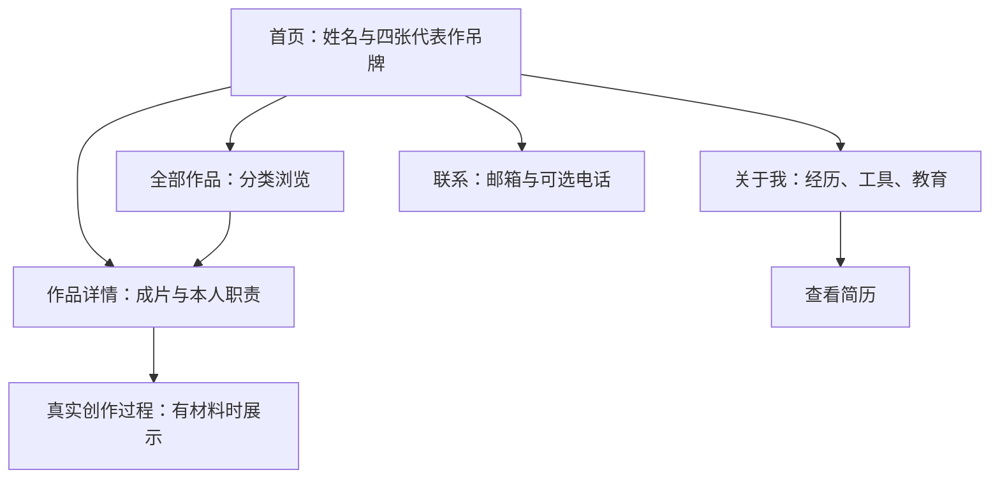

# 黄爱美作品集网站需求文档

版本：V1.0 ｜ 日期：2026-10-13 ｜ 状态：需求初稿，供开发与内容准备使用

## 1. 项目目标

做一个适合求职投递的视频作品集网站。用人方打开后，能看懂黄爱美做过什么、具体负责什么，并通过作品判断画面审美、剪辑水平、内容组织能力和实际交付经验。

已确定的视觉方向是白底、淡紫点缀、细线悬挂的作品吊牌。网页有轻微摆动和翻面互动，文字简短，作品处于主要位置。

本次交付是需求文档及开发安排。网站实现、视频加工和上线按后续阶段推进。

### 1.1 判断网站是否达标

| 用人方需要判断的事 | 网站给出的内容 | 验收方式 |
| --- | --- | --- |
| 是否符合招聘岗位 | 姓名、视频拍剪／短视频剪辑方向、两段相关工作经历 | 首页和关于区域能直接找到 |
| 是否具备审美 | 艺术短片、视觉包装、个人练习及网页的排版 | 无需读长篇自述即可进入代表作品 |
| 是否会剪辑 | 可播放的成片、实际职责、素材与声音的处理说明 | 作品详情能区分本人工作和其他人提供的内容 |
| 是否会组织内容 | 人物故事、文旅叙事、真实创作过程 | 能找到具体的结构和镜头选择，且不夸大为独立编导 |
| 是否能应对工作需求 | 商业口播、模板制作、工作数据、团队协作经历 | 商业作品有明确入口，数字口径清楚 |
| 是否值得联系 | 简历、邮箱、联系方式 | 能查看简历并完成联系操作 |

浏览路径按“快速了解—看一支作品—深入核实”设计。这是本项目的设计假设，不是已有访问数据。

## 2. 材料依据与内容边界

### 2.1 已读取的材料

1. [飞书作品集](https://hq8krg01cra.feishu.cn/wiki/WoAlwpk0Cidf60kq4rrccVY3n9c?from=from_copylink)：作品分类、职责、视频封面和时长，共 20 条作品。
2. [个人简历](/Users/chch/Desktop/剪辑作品集网页/黄爱美-剪辑拍摄-视频剪辑-个人简历(1).pdf)：求职方向、工作经历、教育背景、工具和工作数据，1 页。
3. [用户提供的吊牌参考](/Users/chch/Desktop/剪辑作品集网页/docs/assets/用户提供的吊牌参考.png)：白底、悬挂细线、错落吊牌和浅色卡片。
4. [已接近用户偏好的方向草案](/Users/chch/Desktop/剪辑作品集网页/docs/assets/悬挂吊牌-方向草案.png)：用于明确视觉语言，不作为最终作品封面或完整页面设计。

### 2.2 来源状态

| 内容 | 当前状态 | 使用规则 |
| --- | --- | --- |
| 视频题材、时长和作品集中的职责 | 已从飞书页面读取 | 可作为作品整理依据；导入原视频时再核对实际时长 |
| 任职、工具、工作数据 | 简历明确写出 | 按简历口径展示，不自行增加成果或熟练程度 |
| 作品视频文件、稳定播放地址、独立封面 | 尚未作为网站素材整理 | 进入素材阶段获取并检查；截图和草案不能代替原视频 |
| 脚本、结构草稿、素材比较、剪辑说明 | 当前未提供完整材料 | 可以补充真实过程，不能编造项目过程 |
| 用户参考中的动态效果 | 当前只有截图 | 已观察到悬挂形式；摆动、翻面等是拟实现的交互，需用开发样例验证 |

### 2.3 必须保持准确的地方

- 保司模板中的 AI 人物由公司提供。本人职责是剪辑及视觉包装，不写成本人拍摄或生成这些人物。
- 汽车广告、自然堂 AI 广告属于个人练习，不写成品牌委托项目，不用品牌标识暗示客户关系。
- 现有材料支持素材筛选、文稿理解、内容提炼、镜头编排和叙事剪辑。独立选题、独立写脚本、独立导演等表述，需要相应的真实材料。
- 工作数据来自简历，还没有逐项对应到展示的 20 条作品。不能把公司整体统计或账号累计成果标到某一条视频上。
- 不把尚未确认的奖项名称、任职状态、所在城市或可到岗时间写成事实。

## 3. 网站定位与范围

### 3.1 主要访客

- 内容负责人、视频负责人：关注内容表达、画面、节奏、声音及制作职责。
- 招聘负责人：关注岗位匹配、工作经历、相关作品和联系方式。
- 品牌或创意团队：关注审美、风格适配和创作思路。

### 3.2 首版范围

| 级别 | 内容 |
| --- | --- |
| P0：首版必须完成 | 首页吊牌、20 条作品整理、分类浏览、作品详情与播放、真实职责、关于我、简历查看／下载、联系入口、手机适配、键盘操作、减少动画模式、加载失败处理 |
| P1：素材具备后完善 | 2—3 个重点作品的创作过程；真实短预览；准确对应的成果截图；简历头像用于关于区域 |
| 后续按需要加入 | 新作品更新、英文内容、访问统计、更多案例过程 |

首版按个人展示网站建设。内容由本地资料统一维护，不需要用户登录、管理后台、招聘留言表单或在线简历编辑。

## 4. 页面结构与浏览路径

采用一个主页面，加可单独分享的作品详情。

### 4.1 页面地址

| 页面 | 约定 | 行为 |
| --- | --- | --- |
| 首页 | `/` | 从作品开始，向下浏览全部作品、关于与联系 |
| 首页区域 | `/#works`、`/#about`、`/#contact` | 导航直接定位相应区域；定位后不遮挡标题 |
| 作品详情 | `/works/作品标识` | 可复制地址、直接打开、刷新和后退 |
| 未找到的作品 | 无效详情地址 | 显示“没有找到这件作品”和“返回作品” |

从首页打开作品时，用覆盖页面的详情层呈现，保留首页位置。直接打开详情链接时，呈现同样内容的独立详情页，返回按钮进入作品区域。页面地址与浏览器后退保持一致。

- 从作品列表进入详情，新增一条浏览记录；关闭、Esc 或浏览器后退返回来源，恢复分类、滚动位置和触发按钮焦点。
- 详情内“下一件作品”替换当前详情地址，不叠加覆盖层；停止旧视频，新作品默认显示封面。随后关闭详情仍回到原列表。
- 浏览器前进重新进入详情时，恢复对应作品，但不自动播放。
- 直接访问详情时，“返回作品”进入 `/#works`；独立详情页不使用 Esc 跳走。
- 详情内容加载失败时保留“重试”和“返回作品”，不出现无法关闭的空白详情层。

### 4.2 主页面顺序

1. 顶部：姓名、作品／关于／联系、查看简历。
2. 首屏：简短岗位标题、四张代表作吊牌。
3. 全部作品：按内容类型浏览，列出 20 条已整理作品。
4. 关于我：两段工作经历、工作数据、工具、教育。
5. 联系：邮箱、简历入口及经确认的电话展示方式。

首页吊牌与作品列表使用同一份作品数据。代表作在全部作品中正常出现，作品总数仍为 20，不重复计数。

## 5. 首屏与悬挂吊牌

### 5.1 首屏内容

- 姓名：黄爱美。
- 标题暂定：“视频拍摄”／“与剪辑”，按两行排版。
- 岗位方向：视频拍剪／短视频剪辑。
- 每张吊牌只放作品名、类型、时长、简短职责或“个人练习”、播放入口。
- 更详细的经历与说明放到详情和关于区域。

### 5.2 四张吊牌的首选内容

| 顺序 | 作品 | 想让用人方看到的内容 | 选择理由 |
| --- | --- | --- | --- |
| 1 | 花舞瞬间 | 画面审美、素材选择、音乐与节奏 | 先建立画面印象 |
| 2 | 公司官方账号口播作品之一 | 真人口播拍摄、剪辑和信息表达 | 展示实际商业工作；两条中根据原视频清晰度及代表性选定 |
| 3 | 夏加尔人物故事 | 叙事剪辑、素材编排 | 让用人方看到故事类内容 |
| 4 | 金堂十二时辰 | 文旅叙事、个人创作尝试 | 呈现不同题材和个人探索，明确标注个人练习 |

参考草案中的汽车练习和个人介绍卡，作为作品库和关于区域的素材。最终首屏以以上四类作品组成，兼顾工作内容与个人审美。

### 5.3 吊牌结构

| 正面 | 背面 |
| --- | --- |
| 真实作品封面／真实预览、作品名、类型与时长、短职责、播放按钮 | “我负责的部分”、职责最多 3 行、进入详情的按钮 |

- 吊牌采用浅灰框、柔和阴影、圆角、挂孔和细线。
- 轻微错落，各牌有不同高度和小角度，避免像整齐的商品货架。
- 视频画面区和文字区分别排版，不让视频字幕与网站标题叠在一起。
- 横屏和竖屏作品保持各自比例；可以选真实帧制作封面，不能拉伸成片或裁掉成片字幕。
- 首屏吊牌宽高可略有区别，但作品名、职责及播放入口必须保持清楚。

### 5.4 互动规则

| 操作／状态 | 预期行为 |
| --- | --- |
| 初次进入 | 页面内容先可用，吊牌完成一次轻微落位；不持续晃动 |
| 鼠标靠近吊牌 | 牌面轻微倾斜，幅度约 2—4 度；不随指针夸张追踪 |
| 按住空白牌面拖动 | 在有限距离内移动，释放后平缓归位；不改变作品排序 |
| 拖动与点击判定 | 位移超过约 6px 视为拖动，释放后不打开作品；从封面、按钮或链接开始操作时不启动拖动 |
| 点击封面 | 打开作品详情，显示封面；用户在详情中点击后播放，不触发翻面 |
| 点击播放按钮 | 打开作品详情并尝试播放；浏览器限制时保留可点击的播放按钮，不触发翻面 |
| 点击“我负责的部分” | 翻到背面；背面有“返回”和“查看作品” |
| 键盘操作 | Tab 能访问播放与翻面；Enter／空格执行对应动作；拖动不是必需操作 |
| 页面滚动、离开视窗 | 停止无必要的动画，不占用持续渲染 |
| 减少动画模式 | 不自动落位或摆动，翻面改为即时替换内容，完整保留播放与详情 |
| 手机操作 | 停用吊牌拖动，点击直接操作；竖向滚动优先，不拦截页面滚动 |

数字为初始参数，实际以手感、可读性和测试结果调整。翻面后焦点进入当前面可用的返回或详情按钮；隐藏面按钮不可获得焦点。翻面不触发播放。

## 6. 作品库与全部作品清单

### 6.1 分类与展示

分类入口：全部、商业内容、艺术与故事、个人练习。

作品库采用清晰的封面列表或网格。通过真实画面、比例及排版建立变化，整页不继续重复四张吊牌的复杂动画。每项展示作品名、类型、时长和本人职责的短标签。

- 分类点击后立即更新内容；已选分类有明确状态。
- 列表默认不自动播放视频，不同时加载所有视频文件。
- 不设搜索、分页和复杂排序；当前 20 条作品使用分类即可浏览。
- 进入详情后返回，保留分类和滚动位置。

### 6.2 作品清单

以下名称来自飞书文件名或视频封面。数字文件名改为可读名称；暂名只用于整理，上线前核定。

| ID | 展示名称或当前名称 | 时长 | 分类／来源 | 本人职责与备注 |
| --- | --- | --- | --- | --- |
| W01 | 高客线上买保险，为什么非要找你？ | 01:38 | 商业内容／公司官方账号 | 真人口播拍摄、后期剪辑；标题据封面整理 |
| W02 | 做保险线上拓客，如何年入百万？ | 01:37 | 商业内容／公司官方账号 | 真人口播拍摄、后期剪辑；标题据封面整理 |
| W03 | 低利率＋老龄化夹击，泰盈人生2026为你筑牢人生防线 | 02:28 | 商业内容／保司定制模板 | 剪辑、标题、贴图、字幕、视觉包装；人物为公司提供的 AI 示例 |
| W04 | 在泰康之家，一张保单实现的四季旅居梦 | 02:23 | 商业内容／保司定制模板 | 同上 |
| W05 | 市场波动加剧，中意人寿如何让财富穿越周期？ | 01:58 | 商业内容／保司定制模板 | 同上 |
| W06 | 75载“与国同行”，中意守护“国之重器” | 02:00 | 商业内容／保司定制模板 | 同上 |
| W07 | 通用模板示例：单亲妈妈主题（暂名） | 01:59 | 商业内容／小程序通用模板 | 剪辑和视觉包装；原文件名为“示例视频”，正式名称待核定 |
| W08 | 《给阿嬷的情书》，让我懂了年金险的意义！ | 01:33 | 商业内容／小程序通用模板 | 剪辑、标题与贴图、字幕、视觉包装 |
| W09 | 分红险1.5%和1.75%差多少？红利演示越高越好吗？ | 01:29 | 商业内容／小程序通用模板 | 同上 |
| W10 | 通用模板示例 B（暂名） | 01:49 | 商业内容／小程序通用模板 | 同上；原文件名为“示例视频(7)”，正式名称待核定 |
| W11 | 花舞瞬间 | 00:55 | 艺术与故事／艺梵 | 素材查找筛选、画面编排、音乐匹配、节奏；标题据封面整理 |
| W12 | 神奇的蛋糕 | 01:05 | 艺术与故事／艺梵 | 同上 |
| W13 | 梦幻绘画 | 00:59 | 艺术与故事／艺梵 | 同上；标题据封面整理 |
| W14 | 趣味摄影 | 01:10 | 艺术与故事／艺梵 | 同上 |
| W15 | 夏加尔：人物故事（整理名称） | 02:51 | 艺术与故事／艺梵 | 素材筛选、画面编排、音乐与叙事节奏；原文件名“夏加尔剪辑” |
| W16 | 钱锺书与林徽因：人物故事（整理名称） | 04:13 | 艺术与故事／艺梵 | 同上；原文件名“故事类混剪”，名称据封面内容整理 |
| W17 | 汽车广告视觉短片 | 00:57 | 个人练习／广告 | 以奔驰汽车为题材的视觉剪辑练习；非品牌委托 |
| W18 | 金堂十二时辰 | 03:31 | 个人练习／文旅 | 以十二时辰串联风光、建筑、美食与生活；具体创作分工待补充 |
| W19 | 春日与蝴蝶 | 00:45 | 个人练习／视觉叙事 | 女孩与蝴蝶主题；具体素材来源与分工待补充 |
| W20 | 自然堂广告剪辑（AI 视频） | 00:14 | 个人练习／AI 视觉 | 雪山、湖泊等自然景观；非品牌委托，生成与剪辑分工待补充 |

成片标题可以保留作品原有表达；网页新写的介绍遵循第 10 节的简洁文案规范。W01、W02、W07、W10、W15、W16 的展示名称在素材整理时最终确认。

## 7. 作品详情与播放

### 7.1 详情内容顺序

1. 作品名、分类、时长、工作项目／个人练习标识。
2. 视频播放器，横屏宽幅展示，竖屏居中展示。
3. “我负责的部分”：只写具体工作，通常 1—3 行。
4. “制作说明”：仅在有必要时说明公司提供 AI 人物、个人练习、合作分工或素材来源。
5. “创作过程”：材料齐全的重点作品才展示。
6. 下一件作品、返回作品。

详情不强制每件作品填写背景、挑战、解决方案和成果四段。简单作品只保留必要信息。

### 7.2 视频行为

| 情况 | 要求 |
| --- | --- |
| 点击封面、直接打开链接或刷新详情 | 默认显示封面，不自动播放 |
| 用户点击播放 | 启动当前作品；浏览器限制播放时显示清楚的播放按钮 |
| 播放器能力 | 支持播放／暂停、进度、音量、全屏；手机可内嵌播放 |
| 多个视频 | 同时最多一个成片播放；打开新作品或关闭详情，停止旧视频 |
| 加载中 | 保留封面和加载状态，关闭按钮始终可操作 |
| 失败 | 显示“视频暂时无法播放”、重试和“查看飞书原作” |
| 无稳定视频素材 | 开发时标记缺素材；未经检查的失效临时地址不能作为上线素材 |
| 比例与字幕 | 成片完整呈现，不因卡片或播放器比例裁掉画面与字幕 |
| 页面切到后台 | 暂停本站自行触发的短预览；不擅自恢复播放 |

飞书作品集作为来源和备用入口。首版目标是本站可直接播放，不依赖访客登录飞书，也不把带授权参数或有效期的临时地址写进成品。

### 7.3 可选短预览

在真实素材可用后，为首屏作品准备约 4—8 秒的无声预览。只在鼠标停留且设备适合时播放，同一时间仅一个；移开恢复封面。移动端和减少动画模式不自动预览。使用真实成片片段，不用生成视频替代作品。

## 8. 创作过程与能力证明

优先为以下三个案例整理过程。完成两例即可满足首版深化目标；材料不齐的案例只展示成片与职责。

| 案例 | 要回答的问题 | 可以使用的真实材料 |
| --- | --- | --- |
| 商业口播或保司模板 | 怎样把文稿变成容易看懂的画面？ | 可公开的文稿片段、标题和字幕设计、数据贴图、本人职责；保司示例说明人物由公司提供 |
| 夏加尔人物故事 | 怎样把素材组织成连贯的人物故事？ | 实际结构草稿、镜头序列、素材取舍说明、音乐进入点 |
| 金堂十二时辰 | 十二时辰怎样成为内容线索？本人参与了哪些环节？ | 实际构思、结构草稿、镜头顺序、素材来源或分工说明 |

每个重点案例最多选择 2—3 个关键决定，配真实帧、短片段或可公开的过程图。说明写清“做了什么”和“为什么”，不写空泛的情绪词。

可补充的提问清单：

- 片子最初要讲什么？目标观众是谁？
- 文稿、拍摄、素材和 AI 内容分别由谁提供？
- 本人决定了哪些镜头、段落、字幕或音乐？
- 哪一处删改或调整最影响成片？有没有实际材料可展示？
- 有哪些内容不能公开，需要只保留成片？

不人为制造“修改前版本”、伪造剪辑工程截图或补写成当年的脚本。事后整理的说明标为“剪辑说明”，不冒充原始创作记录。公众页面隐藏缺失模块，不出现“待补充”占位。

## 9. 关于我、简历与联系

### 9.1 简短介绍

暂定文案：

> 黄爱美，视频拍剪／短视频剪辑。做过知识科普、艺术赏析和人物故事，也有口播拍摄经验。

两段经历按时间倒序展示：

| 时间 | 公司／岗位 | 网页简短说明 |
| --- | --- | --- |
| 2025.07—2026.06 | 加保科技深圳有限公司／视频剪辑师 | 负责“加保视频工厂”小程序和主站的视频制作与更新，完成文稿提炼、画面包装及成片交付；与文案、运营和技术团队协作迭代模板 |
| 2024.09—2025.06 | 上海艺梵电子商务有限公司／视频剪辑师 | 为“匠心之城”“艺非凡的礼物”制作人物故事、艺术赏析和生活趣味视频，负责剪辑、调色、音效及素材整理 |

不显示“至今”，不自行推断当前任职或空档经历。

### 9.2 工作数据

| 简历提供的数字 | 页面允许的含义 | 不允许替换的含义 |
| --- | --- | --- |
| 300+ | 知识科普类视频／模板制作数量 | 300 个品牌客户、300 次广告委托 |
| 3万+ | 模板视频累计跟拍数量 | 播放量、粉丝数量、销售转化 |
| 90+ | 文化类混剪视频制作数量 | 当前网站展示视频总量 |
| 10 条 | 点赞或转发量过万的作品数量 | 每条都有万赞、点赞与转发相加过万 |

这些数据作为简历提供的工作统计，用简短文字行展示。详细统计口径及截图在素材阶段确认；如果确认不了，保留简历下载，网页暂不单独使用争议数据。没有具体作品对应证据时，不给 W01—W20 添加“过万”标识。

### 9.3 工具、教育与奖项

- 剪辑：Premiere、剪映。
- 平面与包装：Photoshop、Illustrator；能力说明可写基础 MG、花字、贴图与画面设计。
- 拍摄：相机基础操作、口播拍摄。不扩写为摄影指导或专业灯光团队经验。
- AI 辅助：ChatGPT、Midjourney、即梦 AI，放在工具补充中。
- 教育：桂林电子科技大学，艺术与设计学院，室内设计，2020.09—2024.06。
- 简历可清楚辨认的奖项：大学生广告设计大赛三等奖、第四届电影海报设计优秀奖。奖项完整名称、级别和证明未确认前，不追加“全国”等范围。
- 简历中“第三届市场调查与分析优秀奖／优秀学生奖学金”的换行和名称边界不清楚，先在材料清单中核定，再写入网页。

工具使用文字列出，不设熟练度百分比或进度条。简历头像可用于关于区域；不自动替换成 3D 人物或生成肖像。

### 9.4 简历与联系

- “查看简历”打开 PDF；“下载简历”提供明确文件名。下载失败时仍能打开 PDF。
- 联系入口默认优先邮箱 `825019917@qq.com`，可点击打开邮件应用，也可复制。
- 复制完成显示“已复制”；权限限制或复制失败时让用户直接选择文字复制。
- 电话 `18260955840` 来自简历。正式公开前确认页面是否直接展示电话、是否公开原版简历以及是否需要公开版 PDF。
- 不新增微信号、二维码、地址或第三方联络账号。
- 不发送测试邮件或自动替访客提交求职消息。

## 10. 文案规范

### 10.1 规则

- 作品名用来识别作品，职责说明用来识别本人工作。
- 句子短，使用具体动作：拍摄、剪辑、筛选、编排、调色、配乐、字幕。
- 同类项目共享简洁职责，不给每条视频添加一段重复介绍。
- 模块标题采用“作品”“我负责的部分”“工作经历”“联系”等直接说法。
- 不写无证据的“精通”“卓越”“高转化”“爆款”“独立编导”。
- 少用“赋能”“沉浸式”“用镜头讲述”“让每一帧”“视觉叙事的力量”等泛化表达。
- 不让每个标题再带一句解释性副标题。

### 10.2 可直接用于页面的文字

| 位置 | 文案示例 |
| --- | --- |
| 岗位方向 | 视频拍剪／短视频剪辑 |
| 花舞瞬间吊牌 | 艺术短片 · 00:55；素材筛选／剪辑／音乐 |
| 口播详情职责 | 负责口播拍摄和后期剪辑。 |
| 艺术作品职责 | 负责素材筛选、画面编排和音乐匹配。 |
| 保司模板职责 | 负责剪辑、标题、贴图和字幕排版。 |
| 保司制作说明 | 人物由公司提供，我负责剪辑和视觉包装。 |
| 个人作品标识 | 个人练习 |
| 文旅介绍 | 以十二时辰串联金堂的风光、建筑、美食和生活。 |
| 过程入口 | 看剪辑说明 |
| 失败提示 | 视频暂时无法播放；重试；查看飞书原作 |

上线前按具体素材校正文案，不为了凑字数延长介绍。

## 11. 视觉与手机适配

### 11.1 视觉约定

- 白色页面，近黑正文，灰色辅助文字，淡紫用于强调和选中状态。
- 浅色文字的实际对比度需要检查，不用参考图中偏淡的颜色承担关键说明。
- 中文以清晰、自然的无衬线字体为主，最多两种字体；优先复用系统字体，定制字体需有可用授权。
- 正文约 14—16px，手机关键内容不小于 14px；首屏标题约 40—56px，具体随宽度调整。
- 用留白、对齐、画面比例和细分隔线组织内容。只有吊牌需要明显的圆角与阴影。
- 不增加漂浮粒子、满屏光效、持续跑马灯、鼠标替代图标或无意义的装饰动画。

B 阶段形成一份桌面和手机的可操作吊牌样例，作为后续视觉比较基准。检查白底淡紫、挂孔细线、错落高度、文字清楚、真实封面及无持续摆动；摆动角度参数不能代替实际观感检查。

### 11.2 不同屏幕

| 宽度 | 展示策略 |
| --- | --- |
| 1024px 及以上 | 首屏四张悬挂吊牌；作品库通常三列；详情按内容宽度展示 |
| 640—1023px | 吊牌可分两组或两行；不强行缩小四张；作品库两列 |
| 640px 以下 | 吊牌一列，保留挂孔和短挂线，减少阴影与动画；作品库一列；详情接近全屏 |

- 手机允许滚动后看到其他代表作，不要求四张作品挤进一屏。
- 主要按钮触控区域至少约 44×44px。
- 视频详情适配横竖屏旋转；长作品名换行，不盖住播放入口。
- 页面本身无横向溢出；不靠横向拖拽才能访问作品。
- 顶部导航在窄屏简化为必要入口，查看简历在关于和联系处仍可找到。

## 12. 素材、加载与可用性

### 12.1 每条作品需要的素材

| 素材 | 必需程度 | 要求 |
| --- | --- | --- |
| 原视频或稳定可用播放文件 | 必需 | 核对画面、声音、时长、是否带内部信息；访客可播放 |
| 真实封面 | 必需 | 来自真实成片或原有封面，能识别作品；不使用生成草案的替代画面 |
| 作品信息 | 必需 | 唯一标识、名称、分类、时长、本人职责、工作／练习属性 |
| 原作品链接 | 必需 | 飞书链接与作品定位关系；至少保留作品集备用入口 |
| 短预览 | 可选 | 从真实成片选取，约 4—8 秒，无声，小文件 |
| 创作过程图片或短片段 | 重点案例可选 | 不含内部敏感信息，明确本人参与环节 |
| 简历 PDF | 必需 | 可读可下载；公开版本在上线前确认 |

读取飞书时已观察到多数视频以竖屏容器展示，部分艺术片画面含横屏内容和黑边；个人练习包含横屏和竖屏。最终比例以导入文件为准，不仅依据飞书容器或截图。

### 12.2 文件与播放准备

- 获取视频时不改变飞书权限、不扩大账号授权，不把登录凭证带进网站。
- 为网站准备播放兼容的文件，常规目标为 MP4（H.264 视频、AAC 音频）；有兼容性问题再调整。
- 网页封面优先使用压缩后的 WebP／AVIF，提供必要回退。实际选择以设备兼容和清晰度检查为准。
- 保留原视频备份；压缩及封面作为新文件生成。
- 长视频与页面代码分别管理；根据总体文件体积选择静态资源或视频存储。上线前核对可公开地址、带宽和是否产生费用。
- 不将完整视频嵌入代码、图片 Base64 或需求文档，不在首次进入时下载 20 个视频。

### 12.3 加载目标与验收条件

- 首页先展示文字、封面和操作入口，播放文件按需加载。
- 首屏所需页面资源目标不超过约 2MB，不含用户点击后的视频和简历下载。
- 在约 10Mbps、100ms 往返延迟、空缓存的测试条件下，首屏主要内容目标 3 秒内可见。记录实际测试环境及结果；超标时先优化资源，不删掉必要内容。
- 最长视频做一次完整播放检查；其余视频检查开始播放、跳转进度、声音及结尾。
- 弱网、断网、封面失败、视频失效都保持布局稳定和可返回。
- 字体加载、封面加载或动画库加载失败时，姓名、作品名、职责和链接仍可读。
- 没有短预览时仅展示封面；没有过程材料时不显示过程区域。

### 12.4 无障碍与基础分享信息

- 播放、翻面、分类、关闭等控件有明确名称和焦点样式。
- 详情覆盖层打开后焦点进入详情；关闭后返回触发按钮；支持 Esc 关闭。
- 尊重系统减少动画设置；不以动画或鼠标悬停作为唯一信息入口。
- 首页标题使用“黄爱美｜视频拍摄与剪辑作品集”，分享摘要只写实际内容类型。
- 作品详情包含作品名和简短职责；分享图采用真实作品封面，不放联系方式。
- 默认不接入第三方访问追踪。需要统计时单独确定目的、工具和费用。

## 13. 内容维护与开发约定

### 13.1 维护方式

作品信息集中放在一份内容文件中，页面组件读取这份资料。更新作品时只需补齐素材、修改作品数据，不在多个页面重复改文字。

| 字段 | 内容规则 |
| --- | --- |
| id／slug | 唯一标识及稳定分享地址；标题变化不轻易改变旧链接 |
| title／category／duration | 作品名称、分类、实际时长 |
| projectType／organization | 工作项目或个人练习、来源公司／账号；练习不得填成品牌客户 |
| responsibilities | 本人具体职责；未知环节留在内部待办，不写到公众页面 |
| productionNote | AI 人物、分工等必要说明；无说明则不显示 |
| poster／video／preview | 封面、播放文件及可选短预览 |
| sourceUrl | 原作或原作品集入口 |
| featured／order | 是否首页代表作、展示次序 |
| process | 可选真实过程材料，含说明和图片／片段 |
| evidence／status | 仅内部使用的材料来源及准备状态，避免把内部整理信息显示给访客 |

### 13.2 初步实现方案

- 拟采用 React + TypeScript + Vite，建设可静态部署的前端网站；页面、内容和资源分开维护。
- 视频优先使用浏览器原生播放能力；不为常规播放引入复杂视频平台。
- 吊牌先用页面元素、图片及轻量动画实现，验证质感和手感后再决定是否需要额外方案。首版不以复杂 3D 场景为前提。
- 使用路径形式的作品详情，部署时必须配置详情地址刷新回退；否则在正式发布前调整为兼容的地址方案并更新此文档。
- 开发、依赖安装和脚本统一使用 pnpm；当前环境为 `10.13.1`，新项目的 `packageManager` 写入具体版本，保留 `pnpm-lock.yaml`，不混用其他锁文件。
- Node、React、Vite 的实际版本在项目创建时核对兼容性并锁定，不在需求阶段假定“最新版”。
- 初步目录分为页面、吊牌与播放器等组件、作品数据、封面与视频资源、文档。实施时可调整目录名，不改变内容单一来源原则。

以上是针对本项目规模的实现建议。React 官方文档包含使用 Vite 创建项目的路径；Vite 文档说明构建及部署路径处理。[React 文档](https://react.dev/learn/build-a-react-app-from-scratch)、[Vite 构建文档](https://vite.dev/guide/build.html)。

### 13.3 发布安排

需求阶段不绑定付费服务和域名。先完成本地可运行版本及生产构建，再根据视频体积、访问地区、现有账号和预算选择托管方式。

公开发布前确认：视频和案例是否可公开、公开简历版本、电话展示、域名／托管／视频存储及费用。确认后再发布，不上传内部工程或账号凭证。

## 14. 开发阶段与交付安排

顺序按内容依赖安排，素材收集可与页面开发同时推进。下面的用时是素材齐全、单人开发、反馈及时情况下的工作量粗估，不是确定上线日期。

| 阶段 | 工作 | 产出／完成条件 | 粗估 |
| --- | --- | --- | --- |
| A. 需求与素材核定 | 确定首屏四作；核对 20 条作品名称、职责、视频；核定简历数字与公开信息 | 本文更新、完整作品清单、缺失素材清单 | 0.5—1 天，补素材的等待另计 |
| B. 页面与吊牌样例 | 桌面／手机布局；1 张真实作品吊牌的摆动、拖动、翻面；作品详情样例 | 可操作的本地样例，验证参考质感、文字密度及手感 | 1—1.5 天 |
| C. 完整内容与播放 | 四作首屏、全部作品、分类、详情地址、原生播放、关于、简历、联系 | 完整浏览路径，可使用真实内容 | 1.5—2 天 |
| D. 素材优化与案例 | 必需的封面／视频检查；材料齐全时补短预览和重点案例过程 | 20 条素材清楚可播；可选过程与职责相符，缺少时隐藏 | 0.5—1.5 天，取决于材料 |
| E. 体验检查与修正 | 手机、键盘、减少动画、弱网、失效地址、返回位置、文案核查 | 修正问题；完成验收记录和生产构建 | 0.5—1 天 |
| F. 发布准备 | 选择托管、检查公开版本、确认费用与权限 | 可发布包、部署说明；实际发布另行执行 | 按选定平台评估 |

预计本地完整版本约 4—7 个工作日，过程材料准备、额外设计调整和线上托管等待另计。

A 阶段先取得首屏四作的可用素材和必要职责，即可开始 B 阶段；其他视频整理同时推进。首屏口播先标记 W01／W02 为候选，完整查看原片后选定。首版完成条件是 20 条稳定可播作品、真实封面、准确职责及 P0 页面功能；过程、短预览和成果截图可以缺省，缺省时隐藏对应模块。

### 14.1 可拆分的开发任务

1. 建立 pnpm 项目与基础页面，锁定版本。
2. 建立 20 条作品数据及素材检查表。
3. 实现顶部导航、页面区块和不同屏幕布局。
4. 实现吊牌外观、轻微摆动、拖动判断和独立翻面入口。
5. 实现作品列表、分类和返回状态保留。
6. 实现详情地址、播放器及单视频播放管理。
7. 接入两段经历、工具、教育、简历与联系方式。
8. 接入真实过程资料；完成图片与视频加工。
9. 检查交互、失败状态、键盘、手机和文字。
10. 生成可发布版本及使用／更新说明。

每个阶段结束展示可检查的结果。视觉细节先通过吊牌样例验证，再扩展到全部作品。

## 15. 验收清单

### 内容

- [ ] 20 条作品一一对应，分类为 10 条商业内容、6 条艺术与故事、4 条个人练习。
- [ ] 首屏四作涵盖艺术、商业口播、人物故事和文旅练习，能打开同一作品详情。
- [ ] 数字文件名和暂名已整理；标题、时长和职责与真实材料一致。
- [ ] AI 人物提供方、个人练习属性及实际创作分工说明准确。
- [ ] 两段工作经历与简历一致；工作数据没有变成播放量、客户数或单片成果。
- [ ] 关于内容、简历、邮箱和电话经过核对；模糊奖项没有擅自扩写。
- [ ] 公众页面没有“待补充”、示例头像、假二维码或生成草案替代的作品画面。

### 页面与互动

- [ ] 1440px、1024px、768px、390px 和 360px 宽度下内容可读，无横向溢出。
- [ ] 对照 B 阶段桌面／手机样例检查悬挂吊牌；白底淡紫、挂孔细线、错落高度和文字清晰度一致，无持续摆动。
- [ ] 拖动释放不误播放，翻面不播放；手机滚动不中断；减少动画后全部内容和操作仍可用。
- [ ] 翻面、播放和进入详情是可区分的操作；手机不依赖拖拽或悬停。
- [ ] 分类、返回位置和焦点保留正确；详情地址可直接打开、刷新、前进和后退；下一件作品不残留旧视频或空白详情层。
- [ ] 所有视频检查播放、声音、进度和结尾；横竖屏没有拉伸或裁掉字幕。
- [ ] 同时只有一条成片播放，关闭详情立即停止播放。
- [ ] 查看／下载简历、邮件入口、复制和失败回退可使用。

### 稳定性与交付

- [ ] 键盘能完成主要操作，详情焦点与 Esc 正确；减少动画模式可用。
- [ ] 在桌面 Chrome／Safari、iPhone Safari、Android Chrome 检查核心路径；没有真实设备的项目明确记录为未验证，不能宣称已通过。
- [ ] 断网、视频失效、封面失败、复制权限受限、无效作品地址均有可恢复状态。
- [ ] 在约定条件下记录首屏体积和加载时间；超标问题有修正或明确记录。
- [ ] pnpm 生产构建通过，关键交互无阻塞错误，资源路径和详情回退符合部署方案。
- [ ] 自动检查只覆盖作品数据完整性、分类／地址和播放状态等关键行为；摆动手感与画面质量通过实际体验检查。
- [ ] 有内容更新说明、素材存放说明和发布步骤；公开发布所需信息已确认。

## 16. 开发前待补齐的材料与决定

这些项目不影响需求初稿完成，但影响对应模块落地和上线。

| 项目 | 为什么需要 | 当前处理 |
| --- | --- | --- |
| 20 条原视频或可用文件 | 保证本站稳定播放、校验比例和声音 | 素材阶段整理；优先获取首屏四作 |
| 两条口播中首屏用哪条 | 选择最有代表性且清晰的一条 | 根据完整原片比较，再确认 |
| W07、W10 及整理名称 | 避免“示例视频”或数字名进入正式网站 | 核定实际主题和名称 |
| 个人练习的素材与创作分工 | 区分剪辑、生成、策划和拍摄 | 先标个人练习，不增加未知职责 |
| 2—3 个重点案例的真实过程 | 给内容组织、叙事和编导相关能力提供证据 | 材料齐全才增加过程区域 |
| 工作数据的具体统计口径 | 准确区分产量、跟拍和点赞／转发 | 使用简历口径，争议数字核定后上线 |
| 奖项完整名称 | 简历个别换行有歧义 | 未核定的奖项暂不写进网页 |
| 当前求职城市、到岗时间 | 简历没有，招聘可能关心 | 首版先不展示，提供后可补 |
| 公开简历与电话展示方式 | 网站上线后访客可获取这些信息 | 发布准备阶段确认 |
| 托管、域名、视频存储与预算 | 决定公开地址、稳定性和成本 | 本地完整版本完成后选择 |

## 17. 交付物

### 本轮

- 本需求文档、其中的开发计划及材料缺口清单。
- 已选视觉方向及用户参考的本地副本，便于后续开发对照。

### 后续开发阶段

- 网站源代码、锁定依赖及可发布构建。
- 20 条作品的统一内容资料、真实封面、播放素材及可选预览。
- 可公开的简历文件及已补齐的创作过程材料。
- 关键路径验收记录、内容更新说明和发布说明。

### 修订记录

| 版本 | 日期 | 内容 |
| --- | --- | --- |
| V1.0 | 2026-10-13 | 结合飞书作品集、项目目录中的简历、用户选定的吊牌视觉方向，形成完整需求及阶段开发安排 |
